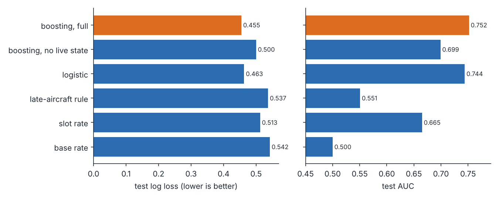
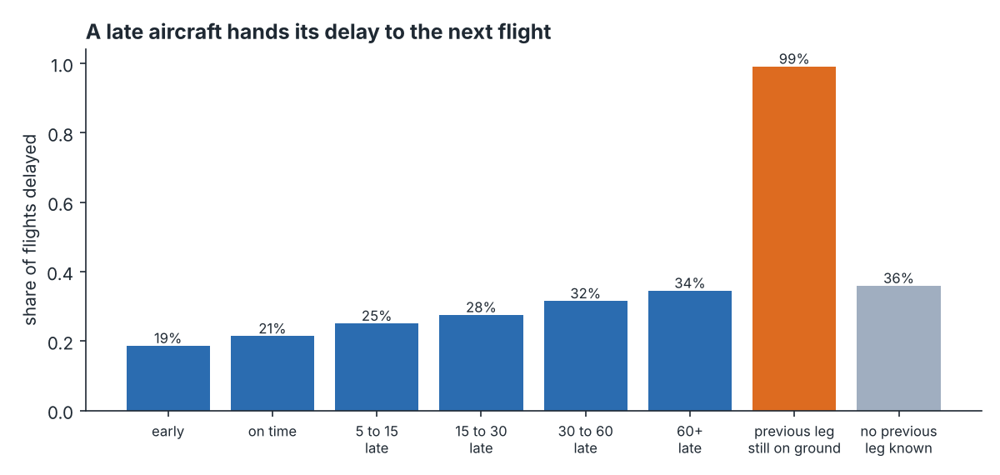
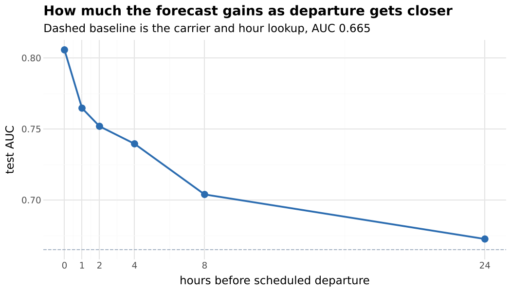
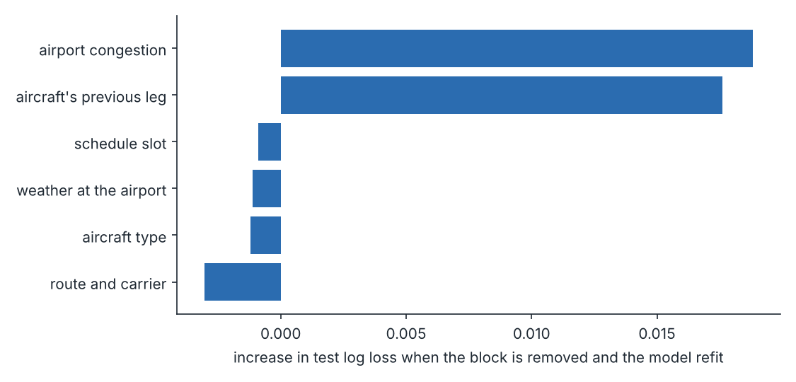
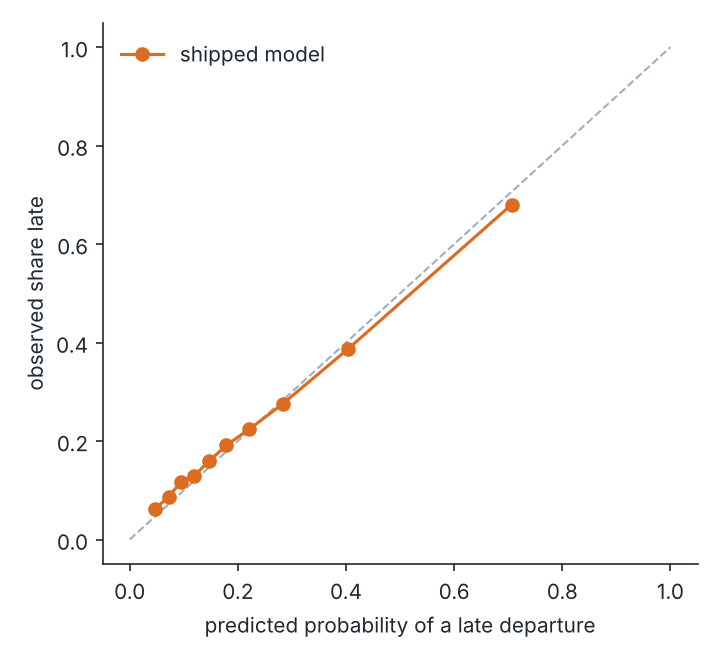
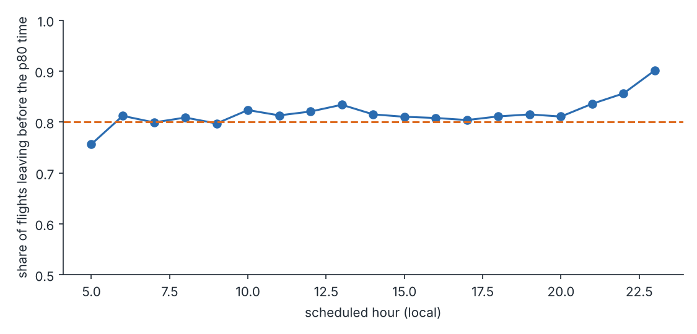
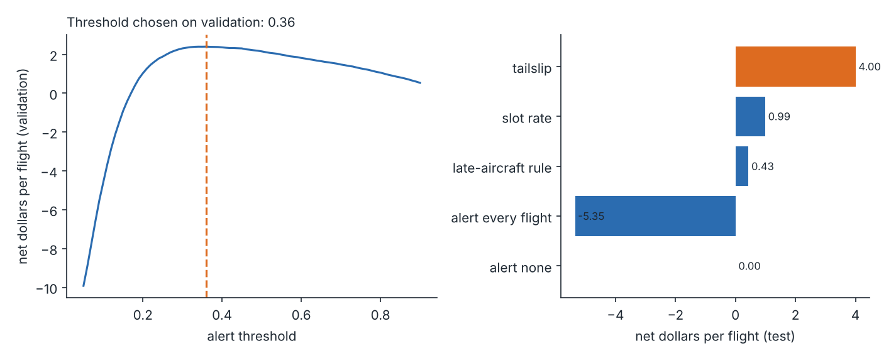
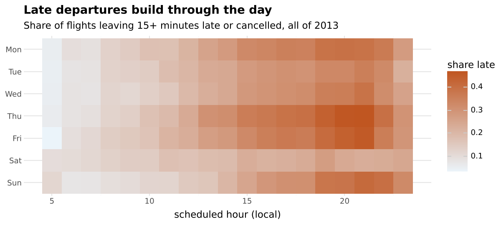

# tailslip

[](https://github.com/ranjithguggilla/tailslip/actions/workflows/ci.yml)

Departure delay forecasts for New York flights that look at the aircraft, not just the schedule.

A plane that leaves late in the morning is usually late again in the afternoon. The data for that is sitting in the flight log: the same tail number shows up flight after flight, and what happened to its last departure is known before its next one. tailslip builds a forecast two hours before each scheduled departure from three live signals (the aircraft's previous leg, how backed up the airport is right now, and the latest weather), keeps every one of them strictly to what a planner could have known at that moment, and turns the result into an alert rule with a stated dollar value.

On 55,060 held-out flights from November and December 2013 the model ranks late departures with an AUC of 0.752 (95% interval 0.727 to 0.769), against 0.665 for the usual carrier-and-hour lookup. Under the cost assumptions written down below, the alert rule nets about $4.00 per flight, against $0.99 for the lookup and a loss of $5.35 for alerting everything.

## Results

The data is every flight out of Newark, JFK and LaGuardia in 2013 (334,264 flights after removing 2,512 records with no tail number, see the leakage note below). A flight counts as delayed if it left 15 or more minutes late or was cancelled, which is 23.5% of the year. Training uses January to August (222,969 flights, 25.6% delayed), model selection uses September and October (56,235, 15.6%), and the test set is November and December (55,060, 23.1%). The delay rate drops sharply in autumn and comes back in winter, so the split is a real test of drift and not just of memorisation.

### Model comparison, two hours before departure

| model | validation log loss | test log loss | test AUC [95% CI] | test ECE |
|---|---|---|---|---|
| base rate | 0.463 | 0.542 | 0.500 [0.500, 0.500] | 0.0782 |
| slot rate | 0.435 | 0.513 | 0.665 [0.649, 0.679] | 0.0270 |
| late-aircraft rule | 0.456 | 0.537 | 0.551 [0.543, 0.559] | 0.0579 |
| logistic | 0.373 | 0.463 | 0.744 [0.721, 0.765] | 0.0062 |
| boosting, no live state | 0.400 | 0.500 | 0.699 [0.670, 0.723] | 0.0374 |
| boosting, full (shipped) | 0.355 | 0.455 | 0.752 [0.727, 0.769] | 0.0141 |

Intervals come from a bootstrap that resamples whole calendar days, because flights on the same day share weather and congestion. The shipped model is the simplest candidate within one standard error of the best validation log loss; boosting with the live features won clearly on validation (paired standard error against the logistic model 0.0019, gap 0.0178).

The logistic regression gets close on test (0.744 AUC, 0.463 log loss), and boosting without the live features is worse than logistic with them (0.699). Picking the right inputs mattered more than picking the fancier model.



### The delay travels with the aircraft

This is the fact the project is built on. Among flights whose previous departure is already known at decision time:

| previous departure of the same tail | flights | share delayed |
|---|---|---|
| early | 93,410 | 18.6% |
| on time | 132,856 | 21.4% |
| 5 to 15 late | 28,181 | 25.1% |
| 15 to 30 late | 22,062 | 27.5% |
| 30 to 60 late | 21,314 | 31.5% |
| 60+ late | 25,697 | 34.5% |
| previous leg still on ground | 446 | 99.1% |
| no previous leg known | 10,298 | 35.9% |



The 99% row is a small group (446 flights): the previous leg is still on the ground more than two hours before the next one is due out. A caveat that matters for how much to expect from this: the data only has departures from the three New York airports, so the previous departure is usually the day before (median gap 24.4 hours, and only 26% of flights have one under 12 hours old). Most of the chain signal comes from the minority of same-day rotations.

### Accuracy against lead time

I refit the same model for decisions made at different times before departure.

| hours before departure | test AUC | test log loss | test ECE |
|---|---|---|---|
| 0 | 0.806 | 0.417 | 0.0080 |
| 1 | 0.765 | 0.446 | 0.0103 |
| 2 | 0.752 | 0.455 | 0.0141 |
| 4 | 0.740 | 0.465 | 0.0185 |
| 8 | 0.704 | 0.498 | 0.0366 |
| 24 | 0.672 | 0.516 | 0.0453 |



Forecasting a day ahead (0.672) is barely better than the lookup (0.665). The gain comes in the last few hours, which is when airport state and the aircraft's earlier flight become visible.

### What each block of features is worth

Dropping one block of features and refitting, test results:

| block removed | AUC | log loss | change in log loss |
|---|---|---|---|
| aircraft's previous leg | 0.732 | 0.472 | +0.0176 |
| airport congestion | 0.728 | 0.474 | +0.0188 |
| weather at the airport | 0.754 | 0.454 | -0.0011 |
| schedule slot | 0.752 | 0.454 | -0.0009 |
| route and carrier | 0.753 | 0.452 | -0.0030 |
| aircraft type | 0.752 | 0.454 | -0.0012 |

Removing the aircraft's previous leg or the airport congestion block costs about 0.018 log loss. Removing weather, schedule slot, route and carrier, or aircraft type changes log loss by less than 0.004 in either direction, and each time it improves slightly. I read that as noise plus mild overfitting from the larger boosting configuration chosen on validation, and I did not drop those blocks, because the selection rule was fixed before the ablation. A leaner feature set is a reasonable next experiment, and it should be judged on validation.



Permutation importance on validation, by block (increase in log loss when the block is shuffled):

| block | increase |
|---|---|
| airport congestion | +0.0518 |
| aircraft's previous leg | +0.0299 |
| schedule slot | +0.0226 |
| route and carrier | +0.0163 |
| weather at the airport | +0.0152 |
| aircraft type | +0.0030 |

### Calibration



The shipped model's mean prediction on test is 22.7% against an observed 23.1%, with an ECE of 0.0141. I also tried isotonic recalibration fitted on September and October. It looked good in a September-to-October check (ECE 0.0228 to 0.0070) and then pushed the November and December ECE up to 0.0403. The reason is visible in the data: validation months run at 15.6% delayed and the test months at 23.1%, and a calibrator fitted on a quiet stretch learns the quiet level. I ship the model uncalibrated. That was a decision made after seeing the test numbers, so treat it as informed by the test set. In production the calibrator should be refit on a trailing window, not on a fixed one.

### How late, not just whether

A quantile forest predicts the 50th, 80th and 90th percentile departure delay, so the app can say "four times in five it leaves by 14:20". Test results over 54,145 flights that actually departed:

| quantile | share of flights at or under the forecast (forest) | same for carrier-and-hour lookup | pinball loss, forest | pinball loss, lookup |
|---|---|---|---|---|
| p50 | 51.7% | 53.6% | 7.49 | 8.01 |
| p80 | 81.3% | 82.1% | 8.31 | 9.59 |
| p90 | 91.1% | 91.6% | 6.87 | 7.94 |

Both are close to nominal coverage. The forest's edge is in the pinball loss (the proper score for a quantile), not in coverage. The p80 forecast under-covers at 5 am (75.6%) and over-covers late at night (90.1%).



### What an alert is worth

The alert rule sends a delay warning when the forecast probability crosses a threshold chosen on the validation months. The dollar figures are assumptions, not findings: $60 saved when operations hear about a real delay early (rebooking, gate and crew moves), and $25 wasted on each false alarm.

| strategy | net $ per flight (test) | $ million per year at 2013 New York volume |
|---|---|---|
| alert none | 0.00 | 0.00 |
| alert every flight | -5.35 | -1.79 |
| late-aircraft rule | 0.43 | 0.14 |
| slot rate | 0.99 | 0.33 |
| tailslip | 4.00 | 1.34 |

The validation threshold is 0.36, which alerts 17.4% of flights at 56.4% precision and 42.5% recall. The 95% interval for the net value is $2.70 to $5.37 per flight, and the gain over the lookup is $2.06 to $4.00. A threshold picked with hindsight on the test set (0.29) would earn $4.10, so the validation choice gave up very little.

How much the model is worth depends heavily on the cost ratio, so here are four scenarios, each using the break-even probability as the threshold (no tuning):

| value caught / cost of false alert | break-even probability | tailslip | lookup | alert every flight |
|---|---|---|---|---|
| $60 / $25 | 0.29 | 4.11 | 1.50 | -5.35 |
| $120 / $15 | 0.11 | 17.10 | 16.73 | 16.21 |
| $40 / $40 | 0.50 | 1.45 | -0.21 | -21.50 |
| $100 / $50 | 0.33 | 6.03 | 1.40 | -15.32 |

When a false alarm is cheap relative to a catch ($120 against $15), alerting every flight is nearly as good as the model, and the model adds about $0.90 per flight. The model earns its keep when alerts cost real work.



### Reasons for a single flight

The app gives plain-language reasons by resetting one block of features at a time to a typical flight and measuring how far the odds move. Three flights from the test set:

```
p = 1.00, actual departure delay 85 min
  - the aircraft's previous flight is still on the ground, 93 min past its slot (raises the odds of a delay)
  - EV from EWR to CVG (raises the odds of a delay)
  - recent departures are running 63 min off schedule, with 54 flights queued ahead (raises the odds of a delay)

p = 0.50, actual departure delay -3 min
  - recent departures are running 22 min off schedule, with 52 flights queued ahead (raises the odds of a delay)
  - this aircraft type (raises the odds of a delay)
  - DL from LGA to DTW (lowers the odds of a delay)

p = 0.01, actual departure delay -4 min
  - a 6:00 slot with 21 departures within the hour (lowers the odds of a delay)
  - US from LGA to DCA (lowers the odds of a delay)
  - no recent departures, with 1 flight queued ahead (lowers the odds of a delay)
```

### Who the model works for

| group | flights | actual delay rate | mean forecast | AUC | recall at alert threshold |
|---|---|---|---|---|---|
| origin EWR | 19,508 | 27.0% | 26.3% | 0.736 | 46% |
| origin JFK | 17,799 | 20.3% | 20.0% | 0.736 | 34% |
| origin LGA | 17,753 | 21.7% | 21.5% | 0.775 | 46% |
| carrier UA | 9,671 | 24.4% | 20.3% | 0.694 | 28% |
| carrier B6 | 9,030 | 23.1% | 23.5% | 0.767 | 44% |
| carrier EV | 8,778 | 33.2% | 36.0% | 0.756 | 63% |
| carrier DL | 7,942 | 15.3% | 16.8% | 0.711 | 30% |
| carrier AA | 5,265 | 17.5% | 18.0% | 0.715 | 29% |
| carrier MQ | 4,195 | 23.8% | 23.8% | 0.789 | 52% |
| carrier US | 3,212 | 12.1% | 12.0% | 0.748 | 31% |
| carrier 9E | 3,119 | 24.5% | 23.2% | 0.736 | 42% |

Calibration holds by airport. By carrier it is weakest for UA, where the mean forecast (20.3%) sits below the actual rate (24.4%) and recall at the alert threshold is only 28%. A carrier-level correction would be the first thing to add.

### Leakage checks

- Every flight with no tail number in the source table is a cancellation (2,512 of them), so a missing tail number gives away the label. A first run that kept them scored a higher AUC and put "no earlier flight on record" at the top of its explanations. They are dropped before anything else happens.
- Splitting rows at random across the whole year instead of forward in time gives an AUC of 0.800, against 0.752 for the forward split. The gap of about 0.05 is what a random split would have claimed for free.
- Using the weather recorded at departure time instead of the last observation before the decision gives 0.760 AUC, only 0.008 above the honest version. A perfect weather forecast would add little at a two-hour horizon.
- The streaming implementation of the airport features, built with sorted containers for live use, matches the batch implementation used in training exactly on 2,000 sampled flights (largest absolute difference 0).



## Architecture

```
 flights, weather, planes (nycflights13 tables)
            |
            v
   prepare: UTC times, label, drop untailed rows
            |
            +---------------------------------------------+
            |                                             |
            v                                             v
   decision clock T = scheduled departure - 2h      forward split by month
            |                                      train / validation / test
   +--------+-----------+-------------+
   |        |           |             |
   v        v           v             v
 previous  airport    weather      schedule, route,
 leg of    state at   at T minus   aircraft type
 same tail   T        1 hour
   |        |           |             |
   +--------+-----------+-------------+
            |
            v
   pipeline: encode + gradient boosting  ---> P(delay >= 15 min or cancelled)
   pipeline: encode + quantile forest    ---> p50 / p80 / p90 departure delay
            |
            v
   alert threshold from validation dollars  ---> alert or no alert, plus reasons
```

## Installation

```bash
git clone https://github.com/ranjithguggilla/tailslip.git
cd tailslip
python -m venv .venv && source .venv/bin/activate
pip install -r requirements.txt
pip install -e . --no-deps
```

Python 3.11 or newer. The pinned versions in `requirements.txt` are the ones the reported numbers came from (Python 3.13).

## Usage

1. Fetch the source tables. This downloads the nycflights13 archive from PyPI, checks its SHA-256 and unpacks the csv files into `data/raw/`.

   ```bash
   tailslip fetch
   ```

2. Run the full pipeline: features, model comparison, studies, charts, saved model. It takes about four minutes on a laptop.

   ```bash
   tailslip run
   ```

3. Read the headline numbers.

   ```bash
   tailslip show
   ```

4. Launch the replay app. Pick an airport, a date and a flight from the held-out months, then use the two what-if sliders to change the previous leg's delay or the airport's recent delay and watch the forecast move.

   ```bash
   tailslip app
   ```

`tailslip run --quick` runs a reduced version (fewer lead times, fewer bootstrap draws, no ablation), which the test suite uses.

## Configuration

The settings live as module constants, not a config file, because there are only a few.

| setting | where | default | meaning |
|---|---|---|---|
| `SHIPPED_HORIZON` | `pipeline.py` | 2.0 | hours before scheduled departure at which the forecast is made |
| `HORIZONS` | `pipeline.py` | 0, 1, 2, 4, 8, 24 | lead times in the accuracy curve |
| `BOOST_GRID` | `pipeline.py` | 3 settings | boosting configurations compared on validation |
| `DELAY_MINUTES` | `data.py` | 15 | minutes late that count as delayed |
| `VALUE_PER_CAUGHT_DELAY` | `evaluate.py` | 60 | assumed dollars saved per caught delay |
| `COST_PER_FALSE_ALERT` | `evaluate.py` | 25 | assumed dollars lost per false alarm |
| `TAXI_IN_MINUTES` | `features.py` | 20 | allowance added to air time to estimate touchdown |

## Output structure

```
outputs/
  metrics.json            every number quoted in this README
  tailslip_model.joblib   fitted model, quantile forest, threshold, reference row (not committed)
  test_replay.parquet     held-out flights with their features, for the app (not committed)
assets/
  *.png                   charts used above
data/raw/                 downloaded source tables (not committed)
```

## Project structure

```
src/tailslip/
  data.py        fetch with hash check, load, labels, UTC times, forward split
  features.py    previous-leg, airport, weather, schedule and aircraft features at a decision time
  state.py       streaming airport book (sorted containers), pinned to the batch features by a test
  models.py      pipelines: boosting, logistic, quantile forest, plus the two baselines
  evaluate.py    metrics, day-block bootstrap, calibration error, alert economics
  explain.py     block-level reasons in plain language
  scoring.py     scoring and what-if functions used by the app
  pipeline.py    end-to-end run, studies, artefacts
  plots.py       charts
  app.py         Gradio replay app
  cli.py         command line
tests/           pytest suite on synthetic flight tables
.github/workflows/ci.yml
```

## Technical details

Features are built at a decision clock `T = scheduled departure - horizon`, and every one of them is checked against `T`:

- Previous leg. The prior departure of the same tail number counts as known only if it left before `T`; touchdown is estimated as departure plus air time plus a 20 minute taxi allowance, and the arrival delay is shown only if that estimate falls before `T`. If the previous flight was due out before `T` and has not left, the feature is how many minutes it is overdue.
- Airport state. Prefix sums over sorted arrays give the number of departures, mean delay and late share in the last hour and last three hours, the number of flights queued ahead of this one that have not yet gone, and the airport backlog. Cancelled flights are left out of this block because the table does not say when a cancellation became known, which is a limitation.
- Weather. The last hourly observation at least an hour before `T`, plus rain and minimum visibility over the three hours before that. Wind readings above 70 mph (a few are instrument glitches over 1,000 mph) are clipped.
- Schedule, route, carrier, aircraft type, seats and age are known well in advance.

All encoding and imputation sit inside the scikit-learn pipelines, so nothing is learned from validation or test rows. Boosting uses ordinal-encoded categoricals handled natively, with unseen categories treated as missing. The three boosting configurations in the grid are compared on validation only; the test months are scored once for the reported tables. The boosting hyperparameters picked were a learning rate of 0.10, 63 leaves and 200 iterations.

Cancelled flights are labelled delayed and excluded from the delay-minutes forecasts, since they never departed.

The two things I would not claim from this: the dollar values are assumptions, and one year of one metro area is one year of one metro area. November and December of a different year could look different.

## Testing

```bash
pip install -r requirements-dev.txt
ruff check .
pytest --cov=tailslip
```

The suite has 40 tests on synthetic tables shaped like the source data. They cover the label and UTC arithmetic, the previous-leg and weather lookups against hand calculations, the decision-time rule (a longer horizon may only know less), the streaming airport book against the batch features, the metrics and the bootstrap, the alert arithmetic, the pipelines (unseen categories, missing values, ordered quantiles), the scoring and what-if functions, and a quick end-to-end run that checks every output file. Coverage is 93%. Continuous integration runs ruff and pytest on every push and pull request, and on main it also downloads the data, runs the full pipeline and uploads the metrics, model and charts as an artefact.

## Data

Flight, weather, plane, airport and airline tables from the nycflights13 dataset (every flight leaving Newark, JFK and LaGuardia in 2013), originally assembled by Hadley Wickham from US Bureau of Transportation Statistics and NOAA data. The Python copy used here is the PyPI package `nycflights13` by Michael Chow (https://github.com/machow/nycflights13), released under CC0. The fetch step pins version 0.0.3 and verifies its SHA-256.

## License

MIT, see `LICENSE`.
